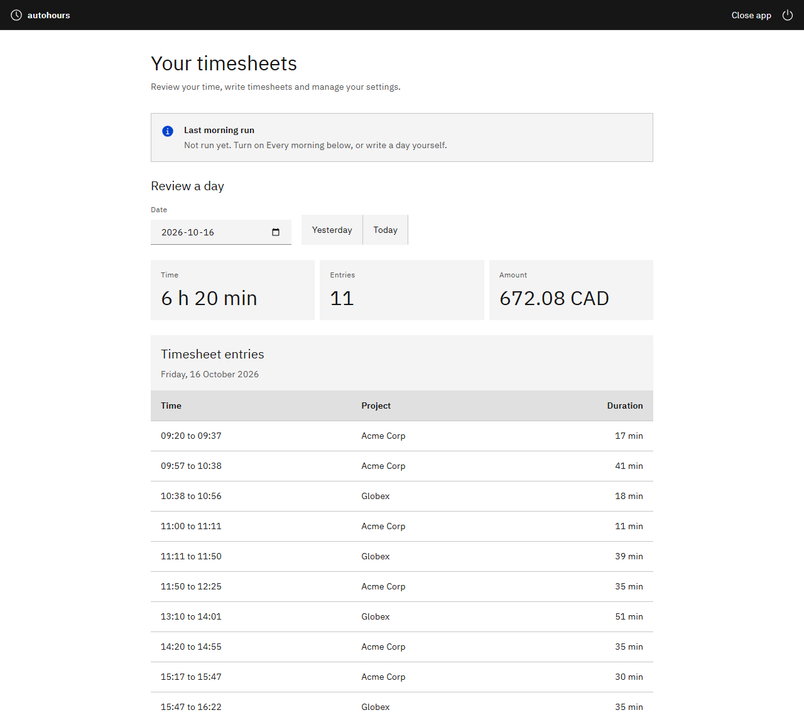
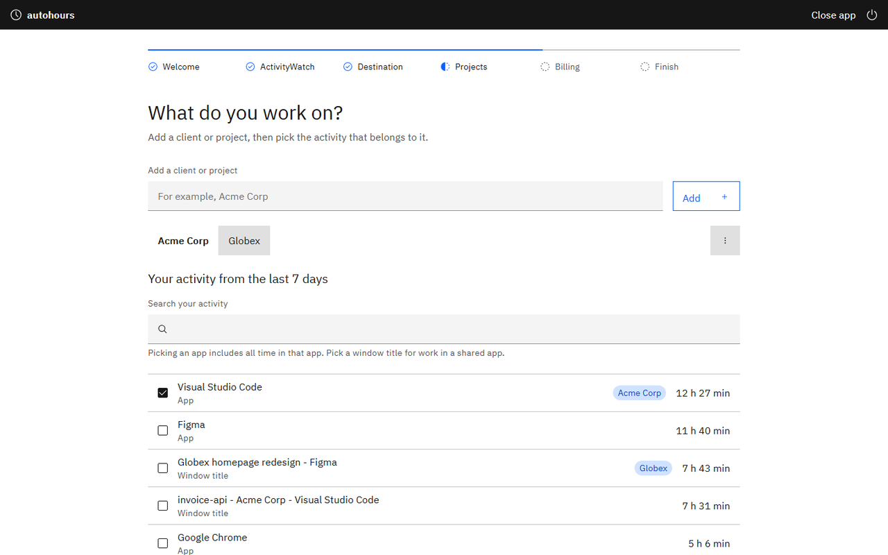
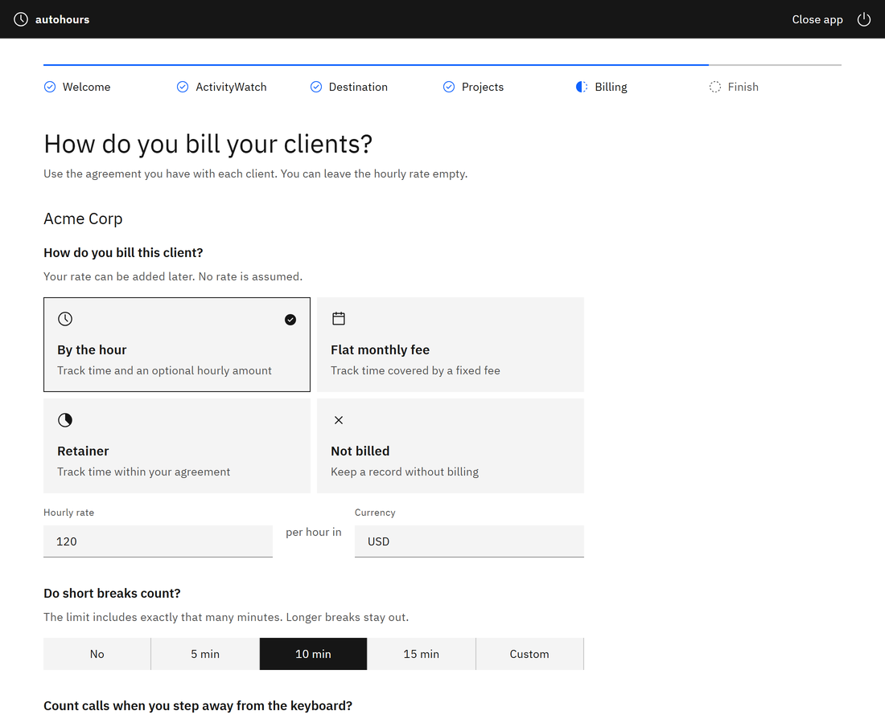

# autohours

[](https://github.com/Gabriel-Dalton/autohours/actions/workflows/ci.yml)
[](LICENSE)

**Your timesheet, filled in from what you actually worked on.**

[autohours.vercel.app](https://autohours.vercel.app)

Time trackers like Clockify only work if you remember to press start when you begin, and stop when you switch clients or step away. Miss either and your hours are wrong, so you end up rebuilding the week from memory.

autohours looks at what you did on your computer, works out which client each piece belongs to, leaves out the time you were away, and fills in your timesheet in Clockify or a spreadsheet. You review each day before it is written, or let it fill in yesterday every morning.

https://github.com/user-attachments/assets/870e3923-da51-4687-8dcd-2c481f40b9cf



## Who it's for

- **Contractors and freelancers** who bill by the hour and would rather not press start and stop on a time tracker all day.
- **Part-timers and people with more than one job**, where each client is billed differently: one hourly, one on a flat fee, one where short breaks count and calls are rounded up.
- **Anyone who forgets to track time** and rebuilds the week from memory on Friday.

## Who it's not for

- **Employers watching staff.** autohours is for tracking your own time on your own computer. It has no team features and sends nothing to anyone else.
- **Work that mostly happens away from a computer.** It only sees what happens on the computer it runs on. You can add calls and meetings away from the computer yourself.
- **Invoicing.** It fills in timesheets; your invoicing tool takes it from there.

## How it works

1. [ActivityWatch](https://activitywatch.net/), a free recorder, notes which apps and windows you use and when you step away. Everything stays on your computer.
2. You tell autohours which apps and windows belong to each client, and how you bill each one. You click through a few screens; there is nothing to write.
3. Each day, autohours turns that into tidy timesheet entries. You review them, then save them to Clockify or a spreadsheet, or let it do yesterday automatically each morning.

| Pick what you work on | Say how you bill each client |
| --- | --- |
|  |  |

Screenshots use made-up demo data.

## Get started

1. Install [ActivityWatch](https://activitywatch.net/downloads/) and leave it running.
2. Download autohours and open it:
   - **Windows:** [autohours-windows.exe](https://github.com/Gabriel-Dalton/autohours/releases/latest/download/autohours-windows.exe)
   - **Mac with Apple silicon (M1 or newer):** [autohours-macos-apple-silicon.zip](https://github.com/Gabriel-Dalton/autohours/releases/latest/download/autohours-macos-apple-silicon.zip)
   - **Older Intel Mac:** [autohours-macos-intel.zip](https://github.com/Gabriel-Dalton/autohours/releases/latest/download/autohours-macos-intel.zip)

   On a Mac, unzip it and move **autohours** to Applications. Not sure which Mac you have? Apple menu > **About This Mac** shows "Chip: Apple" or "Processor: Intel". All versions are on the [releases page](https://github.com/Gabriel-Dalton/autohours/releases).
3. Follow the screens. Setup takes about five minutes.

The downloads are not signed yet, so the first time you open one your computer asks whether to trust it. On Windows choose **More info**, then **Run anyway**. On a Mac, right-click the app and choose **Open**; if that is refused, go to **System Settings > Privacy & Security** and choose **Open Anyway**.

<details>
<summary>Other ways to install</summary>

**One line in a terminal.** This installs everything it needs and opens the app.

Windows (PowerShell):

```powershell
irm https://raw.githubusercontent.com/Gabriel-Dalton/autohours/main/install.ps1 | iex
```

Mac:

```sh
curl -fsSL https://raw.githubusercontent.com/Gabriel-Dalton/autohours/main/install.sh | sh
```

**With Claude Code or Codex.** Say "Help me set up autohours" and point it at [the setup skill](skills/autohours-setup/SKILL.md). Type your Clockify key yourself, never into the chat.

</details>

## Your privacy

- **Window titles and website addresses never leave your computer.** Clockify or the spreadsheet only gets the client, your own description, the times and whether it is billable.
- No account, no tracking, no cloud service.
- Nothing is written until you confirm a day or turn on Every morning, and existing entries are never changed or deleted.

## Known limitations

autohours is used every day on Windows with Clockify. Some setups have not been tried by a real person yet:

- **Mac (experimental).** The Mac apps are built and checked automatically on every release, but no one has run them on a real Mac yet.
- **Linux is not supported.** There is no Linux download and none is planned. The automated tests run on Linux, so it may work from a terminal, but nobody uses it there.
- **Large Clockify workspaces** with many people or hundreds of projects. It has been tested on a personal workspace.
- **Only Clockify and spreadsheets.** Other time trackers such as Toggl or Harvest are not supported yet.
- **Only work on this computer.** It cannot see calls on your phone or work away from your desk. Add that time on Home under Time away from the computer, or in Clockify or your spreadsheet.

If you use one of these setups, please try it and [open an issue](https://github.com/Gabriel-Dalton/autohours/issues) saying what worked and what did not. Fixes and new destinations are welcome too; see [Contributing](CONTRIBUTING.md) and [adding a destination](docs/adding-a-destination.md).

## Questions

**Does it cost anything?** No. autohours and ActivityWatch are free, and Clockify's free plan is enough.

**What if I step away or my laptop sleeps?** That time is left out, unless you agreed with that client that short breaks or calls count.

**Can I undo it?** Delete or edit the entries in Clockify or your spreadsheet. autohours never deletes anything.

**Does it use AI?** No. It only matches the apps and windows you chose for each client.

**Couldn't I just ask an AI to do this?** You could, once. autohours does it every morning, the same way, without your screen history leaving your computer:

- **Private.** An AI would need your full screen history sent to it every day. Window titles hold client names, document names, email subjects and private chats, and sometimes things that should never leave your computer, like a password reset link or an API key in a terminal. Once that is sent to an AI service you no longer control where it is stored or who can see it. autohours reads it on your computer and never sends it anywhere.
- **The same answer every time.** This is billing. The same day always gives the same entries, and "How is this worked out?" shows exactly why, so you can stand behind it if a client asks. An AI can give a different answer each time or invent a block of time.
- **Runs on its own.** It fills in yesterday each morning with no prompting, no subscription and no cost per run.
- **Follows your agreements exactly.** Rounding, short breaks, monthly limits and skipping time you already logged are applied by rule, not by guess.

AI is useful for the one-time setup: working out which apps and windows belong to which client. If you use an AI coding assistant, the [setup skill](skills/autohours-setup/SKILL.md) walks it through that with you.

## Learn more

- [The desktop app, screen by screen](docs/desktop-app.md)
- [How matching and billing work](docs/how-it-works.md)
- [Command line and settings file](docs/command-line.md)
- [Contributing](CONTRIBUTING.md) and [reporting a security problem](SECURITY.md)
- [Changelog](CHANGELOG.md)

Released under the [MIT License](LICENSE). The app's design follows the IBM Carbon Design System; fonts and icons are credited in [CONTRIBUTING.md](CONTRIBUTING.md#credits).
