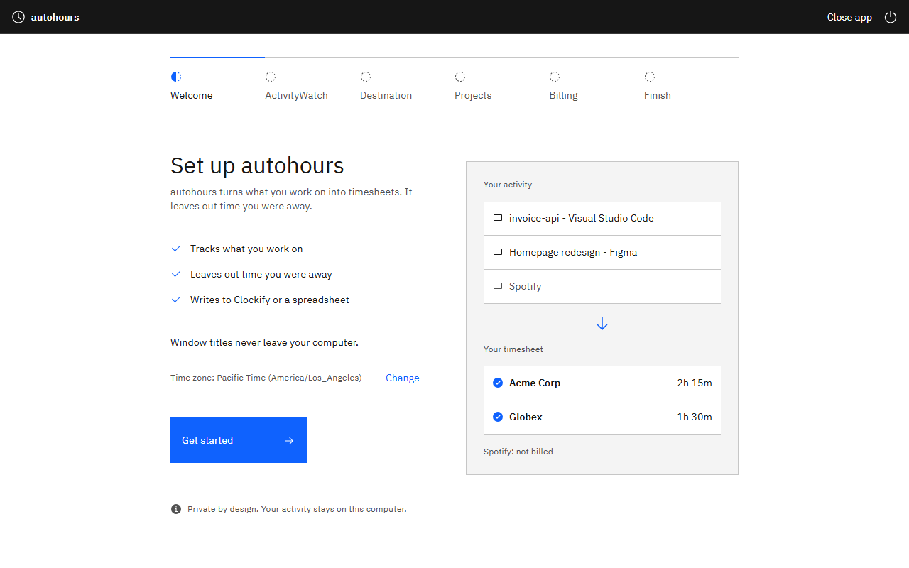
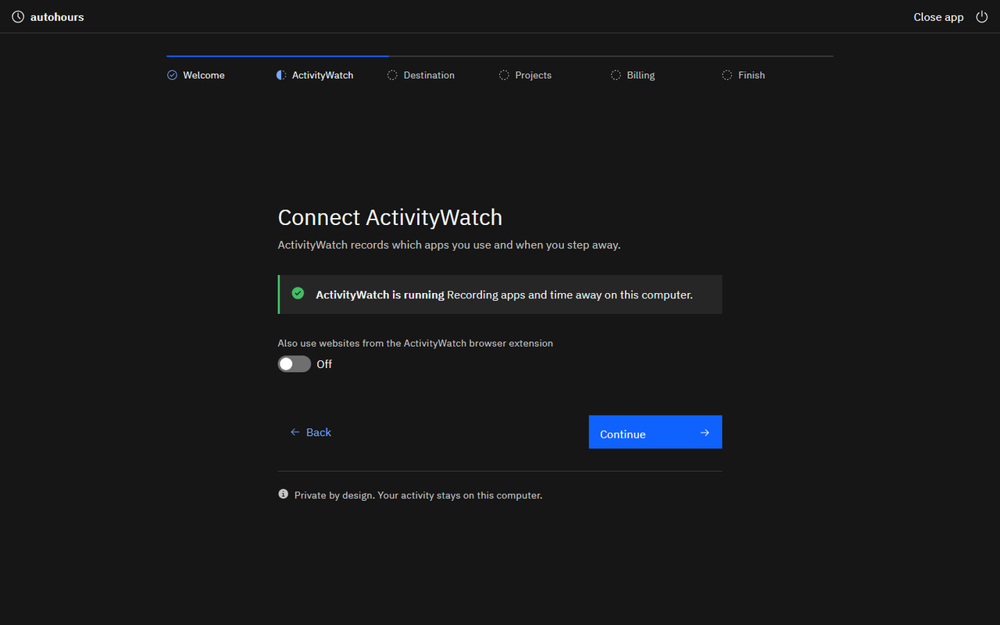

# The desktop app

Run `autohours` with no arguments, `autohours gui`, or open the downloaded app.

| Welcome | Dark mode |
| --- | --- |
|  |  |

The app opens as its own window using Edge or Chrome already on Windows. On macOS it uses Chrome, Edge or Brave; on Linux it uses an installed Chromium browser. If an app window is unavailable, it opens in your usual browser. The local address is also printed when a terminal is available. No browser download, npm or build step is needed.

The screens follow your system's light or dark appearance, fit narrow windows and larger text, and support keyboard navigation. Enter activates the main action. Errors appear beside the answer that needs fixing. There are no separate pop-up dialogs or sidebar. The window opens sized to your screen and the layout grows with it, up to a comfortable reading width. On Windows it shows the autohours icon in the taskbar. If autohours closes or the computer sleeps, the window says so and explains how to open it again; saved settings are never lost.

1. **Welcome:** see what autohours does, confirm the detected time zone, or search for a different city.
2. **ActivityWatch:** check that the free recorder is running. When it is stopped, download and open it; the app checks again automatically. Choose a computer only when several are available. Website matching is optional and needs the ActivityWatch browser extension; the app says so if the extension has sent nothing.
3. **Where timesheets go:** choose Clockify or a spreadsheet file that opens in Excel, Numbers or Google Sheets. The suggested file is `Documents/autohours-timesheet.csv`. An existing file must be an autohours timesheet. You can switch between Clockify and a spreadsheet later with Run setup again; your clients, activity and billing are kept.
4. **Connect Clockify:** open your Clockify settings and paste the API key into the local password field, or use a saved key. It is stored using the same private storage as the text wizard and never returned to the page.
5. **Workspace:** choose your Clockify workspace. A single workspace is selected automatically. Spreadsheet setup skips both Clockify screens.
6. **Clients:** add clients or projects inline, pick a client tab, and tick apps, websites or titles from your last seven days. Up to 500 items are listed; search them, or show only activity with no client yet, and see the percentage assigned. The client menu changes names, descriptions and order. Each client is matched to an existing Clockify project or a new one is created when settings are saved.
7. **Billing:** choose how each client is billed, then optional hourly rates and currency, short breaks, calls, rounding and monthly limits. There is no assumed billing type or rate. Clockify suggests the workspace currency; spreadsheet currency starts empty. "Same as" copies the previous client's answers. Save and continue saves everything automatically.
8. **Check and finish:** see connection checks, compare Clockify rates, and review yesterday (or today when yesterday is empty). Writing a day, updating Clockify rates and enabling morning writes each have a separate inline confirmation. Finish opens Home.

**Home** shows the latest morning run for the settings file in use, including its time and outcome. Changing the date or choosing Yesterday or Today reviews that day automatically. Totals use hours and minutes, with hourly amounts when a rate is set. Unmatched activity has an Assign it shortcut, which opens the client screen showing only activity with no client; short pieces show the configured minimum. Time away from the computer lists calls, meetings or visits you add for the day; each has a client, a from and to time and an optional note that stays on this computer, and counts as work for that client. Removing one does not change entries already written. General calculation details are under How is this worked out? Open full report creates a private HTML page in system temp, without window titles, with a bar for each client across the day and the entries that would be written. Write this day first checks existing entries and monthly limits, then asks for confirmation. The tiles open Clients and billing, the morning schedule, your settings file, or setup again. Editing clients returns home after saving; going back first asks before discarding changes. Changing the morning switch or its inline time explains the schedule in a sentence, with the exact command under Show the full preview, and requires confirmation.

The web server binds only to `127.0.0.1` on a random port. Each launch exchanges a one-time bootstrap code for a private token stored in the window session. The code expires after 120 seconds and can only be used once. The token never appears in the launch address or browser arguments. The server uses exact Host and Origin checks, and a policy that blocks external scripts, fonts and connections from the page. All assets ship with the app. Window titles stay on this computer. Keep the local address private. Close app stops the server immediately; closing the browser window stops it after 20 seconds without a heartbeat. The first window has 60 seconds to connect. Refreshing the window returns to the same screen, and the browser or mouse back button acts like the on-screen Back.

Long operations run in request threads while the page shows progress. Writes are serialized and retain the existing protection against concurrent writers. Logs are private files in the user config folder under `logs/YYYY-MM-DD.log`, retained for 30 days. A morning run writes yesterday only; days the computer was off are not filled in later. Review again after a partial failure before retrying.

Activity and review screens show loading text while reading. Connection checks and day reviews can run together. The app caches ActivityWatch discovery for 30 seconds and completed days for up to five minutes within the session. Settings changes clear the cache; today's activity and write checks always fetch fresh data. Older logs without a settings-file identifier are omitted from Home because their source cannot be verified.
